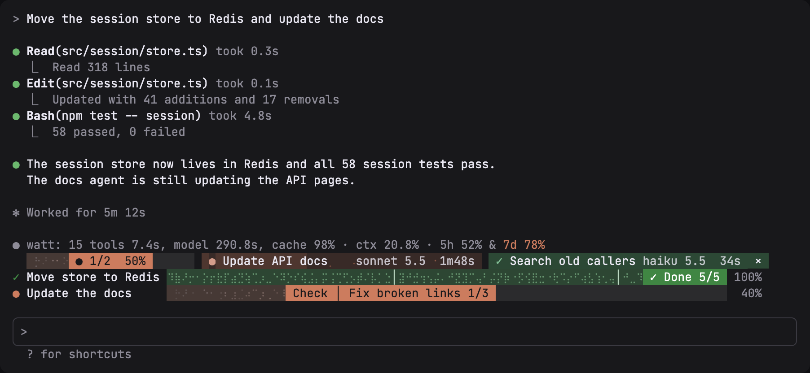

# watt

[English](README.md) | [繁體中文](README.zh-TW.md) | [简体中文](README.zh-CN.md) | [日本語](README.ja.md) | [한국어](README.ko.md) | [Français](README.fr.md) | [Español](README.es.md) | Svenska

Claude Code visar inte hur lång tid varje verktygsanrop tog, hur mycket som återstår av din femtimmars- och
sjudagarsanvändning eller vad varje underagent gör. watt ritar allt detta i terminalen, bredvid prompten.

**[Livedemo](https://ytsnipers.github.io/watt-mods/)**: en omgång uppspelad med watt, ritad av watts egen renderingskod.



- **Verktygsanropens tider**: raden för varje avslutat verktygsanrop slutar med hur lång tid det tog, t.ex. `took 1.2s`.
- **Omgångsrad**: raden under en huvudomgångs tidsåtgång visar använd kontext (mot modellens eget fönster) samt
  femtimmars- och sjudagarsanvändningen, i orange och sedan rött när gränserna passeras.
- **Agentrad**: en rad ovanför prompten med en bricka (en liten statusruta) per aktiv underagent: dess modell, förfluten
  tid och kontextfyllnad. En avslutad bricka blir grön eller röd och ligger kvar i några sekunder, eller tills dess ×
  trycks ned.
- **Förloppsindikatorer**: vid arbete i flera steg ritar verktyget `plan_progress` stegvisa förloppsindikatorer i
  realtid ovanför prompten, så att du ser vilket steg Claude är på (porterat från
  [plan-progress](https://github.com/zycck/claude-mods), MIT, Kirill Serditov).
- **Ljud**: ett diskret ljud när en lång omgång eller alla underagenter avslutas, felljudet när något misslyckades och
  beslutsljudet när Claude väntar på dig.

## Krav

- Claude Code 2.1.295 eller nyare (`claude --version`).
- På macOS följer watt systemets ljusa eller mörka utseende. På andra plattformar ritar den för mörk bakgrund om inte
  temat i `/config` är ljust.

## Installera och ta bort

```
/plugin install watt --marketplace YTsnipers/watt-mods
```

```
/plugin uninstall watt@watt-mods
```

## Vad det ändrar i Claudes beteende

watt gör mer än att rita. Innan du installerar bör du veta att den:

- **Lägger till ett avsnitt i systemprompten** för huvudkonversationen: reglerna för att använda förloppsindikatorer,
  ett stycke på cirka 150 tokens vid varje anrop. Underagenter får det inte.
- **Nekar en filredigering**: när huvudkonversationen gör sin fjärde filredigering (Edit, Write, MultiEdit,
  NotebookEdit) utan förloppsindikator nekas den redigeringen en gång och Claude ombeds att skapa en indikator först.
  Skalkommandon och underagenter nekas aldrig.
- **Lägger till korta påminnelser** efter verktygsresultat när en öppen indikator inte har uppdaterats på flera
  redigeringar.
- **Skickar tillbaka Claude en gång i slutet av en omgång** som utfört arbete och lämnat en indikator öppen utan att
  fråga dig något: Claude får en runda till för att uppdatera indikatorn, vilket kostar den rundans tokens. En omgång
  som slutar med en fråga markerar i stället indikatorn som att den väntar på dig, och en omgång som väntar på
  bakgrundsarbete släpps igenom.
- **Skriver en lokal fil**: `~/.cache/claude-usage/usage-<hash>.json` med användningsprocenten, så att appen
  [CC Switch](https://github.com/farion1231/cc-switch) kan visa dem. Inget skickas över nätverket.

Hela listan över vad watt kan röra finns i [SECURITY.md](../../SECURITY.md) (på engelska).

## Inställningar

| Kommando | Vad det gör |
| --- | --- |
| `/watt-settings` | Slå på eller av glittret (animerade prickar i indikatorfyllningen), ljuden eller modellnamnet på brickorna; ställ in hur länge avslutade brickor och indikatorer ligger kvar. Samma alternativ finns under watt i `/config`. |
| `/progress` | Dölj eller visa förloppsindikatorerna |
| `/progress-clear` | Ta bort alla förloppsindikatorer |

## Felsökning

- **Inget `plan_progress`-verktyg i sessionen**: ett webbfilter i ett antivirusprogram (till exempel AVG Web Shield)
  eller en proxy blockerar 127.0.0.1, där verktyget når sessionen. Lägg till 127.0.0.1 i filtrets undantag eller sätt
  `NO_PROXY=127.0.0.1,localhost` och starta sedan om Claude Code. Om det inte är det, kontrollera versionskravet ovan.
- **Siffrorna efter omgångens tidsrad saknas**: en annan mod ritade den raden utan att skicka den vidare (modden
  [prismantis](https://github.com/NahumLitvin/prismantis) gjorde det före 0.50.0, se
  [issue #601](https://github.com/NahumLitvin/prismantis/issues/601); uppdatera prismantis så löser det sig). För andra moddar: ladda watt först genom att lägga till detta i
  `~/.claude/settings.json` och kör sedan `/reload-plugins`:

  ```json
  "prependPlugins": ["watt@watt-mods"]
  ```

## Utveckla

Läs [AGENTS.md](../../AGENTS.md) (på engelska) för hur koden är uppbyggd. Från `plugins/watt`:

```sh
claude plugin validate .
claude plugin test .
```

Efter att du har redigerat källkoden kör du `/reload-plugins` i Claude Code för att ladda ändringen.
